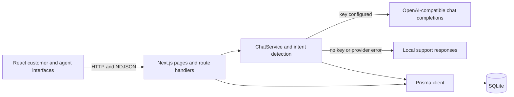

# Technical reference

## Overview

Cheetah Broadband Customer Care is a support-chat prototype for a fictional UK broadband provider. It combines a Next.js 16 App Router interface and API, Prisma persistence on SQLite, optional OpenAI chat completions, and a local rule-based responder. The support status and contact information shown in the interface are demonstration content; the app does not connect to provider account, billing, or network systems.

## Architecture



The customer page creates or loads conversations through the API, then posts messages to `/api/chat`. The chat route returns newline-delimited JSON events so the browser can render streamed AI text. `ChatService` stores the customer message, supplies up to 12 recent turns to the AI provider, and persists the assistant reply. If the provider is not configured or the request fails, the service uses `FallbackSupport`.

Intent detection in `src/lib/intents.ts` uses ordered regular-expression rules. The detected intent supplies guidance to the AI prompt. AI replies may request a human handoff through a function tool; the browser then marks the conversation as needing human support. The explicit “Request a human” action uses the same conversation flag. Human requests appear in the admin inbox, but there is no external ticketing or agent-notification integration.

## Project structure

Next.js maps folders beneath `src/app` to page and API URL segments. Route handlers are implemented with the App Router `route.ts` convention.

| Path | Responsibility |
| --- | --- |
| `src/app/page.tsx` | Customer chat interface, conversation list, streaming, feedback, and handoff actions. |
| `src/app/login/page.tsx`, `src/app/register/page.tsx` | Account sign-in and registration pages. |
| `src/app/settings/page.tsx` | Signed-in profile name and sign-out UI. |
| `src/app/admin/page.tsx`, `src/app/admin/admin-inbox.tsx` | Admin-gated support inbox and conversation review. |
| `src/app/api/` | Authentication, chat, conversation, health, and AI integration route handlers. |
| `src/lib/chat-service.ts` | Message persistence, AI/fallback selection, and conversation orchestration. |
| `src/lib/ai-provider.ts` | OpenAI-compatible API adapter, streaming, escalation tool handling, and connection check. |
| `src/lib/fallback-support.ts`, `src/lib/intents.ts` | Local response rules and intent classification. |
| `src/lib/auth.ts` | Password hashing helpers, JWT session handling, and admin role resolution. |
| `src/lib/prisma.ts`, `prisma/schema.prisma`, `prisma/migrations/` | Prisma client, SQLite schema, and migration history. |
| `src/lib/logger.ts` | Structured Pino server logging. |
| `src/components/` | Shared chat, brand, and UI components. |
| `tests/` | Jest unit tests, Node integration tests, and Playwright end-to-end tests. |

## Web pages

| URL | Description |
| --- | --- |
| `/` | Customer support chat. Guests can chat without an account; signed-in customers see their account's conversations. |
| `/login` | Sign in and receive a session cookie. |
| `/register` | Create a customer account. An email listed in `ADMIN_EMAILS` receives the admin role. |
| `/settings` | View and update the signed-in user's display name, or sign out. |
| `/admin` | Support inbox. The server page redirects guests to `/login` and non-admin users to `/`. |

## HTTP API

All endpoints use the same origin as the Next.js app. JSON endpoints return an `error` property on handled failures. Dynamic route handlers use the conversation ID from the URL.

| Method and path | Purpose and behavior |
| --- | --- |
| `POST /api/auth/register` | Accepts `{ "email": "…", "password": "…", "name": "…" }`; hashes the password with bcrypt, creates the user, and sets a seven-day session cookie. Returns `201`; duplicate email returns `409`. |
| `POST /api/auth/login` | Accepts `{ "email", "password" }`; verifies credentials and sets the session cookie. Invalid credentials return `401`. |
| `POST /api/auth/logout` | Clears the session cookie. |
| `GET /api/auth/user` | Returns the current user or JSON `null` when signed out. |
| `PUT /api/auth/user` | Updates the signed-in user's display name. The name is limited to 80 characters; requires a session. |
| `GET /api/conversations` | Returns conversations and message history. Admins see all; signed-in users see their own; guests see conversations with no `userId`. Human-requested conversations sort first. |
| `POST /api/conversations` | Creates an empty conversation and associates it with the signed-in user when present. Returns `201`. |
| `DELETE /api/conversations/{id}` | Deletes a conversation and its messages. Returns `404` if missing and `403` when an authenticated user tries to delete another user's account-linked conversation. |
| `POST /api/chat` | Accepts `{ "conversationId": "…", "message": "…" }`; message length must be 1–1000 characters. Returns NDJSON events described below. The conversation must exist and pass the route's ownership check; ended conversations return `409`. |
| `POST /api/conversations/{id}/human-request` | Sets `humanRequested`. Rejects ended conversations and account-linked conversations owned by another user. |
| `POST /api/conversations/{id}/reply` | Adds an agent message to a conversation awaiting human support. Admin session required; message length is 1–1000 characters. Returns `201`. |
| `PATCH /api/conversations/{id}/priority` | Clears the `humanRequested` flag. Admin session required. |
| `POST /api/conversations/{id}/feedback` | Accepts `{ "rating": 1..5, "comment?" }`, after an assistant reply. Comments are limited to 500 characters. |
| `POST /api/conversations/{id}/end` | Sets `endedAt` after an assistant has replied. Repeated requests are idempotent. New chat messages are rejected after ending. |
| `GET /api/health` | Executes a database connectivity check. Returns `503` when SQLite is unavailable. |
| `GET /api/integrations/openai` | Reports `unconfigured` when there is no key; otherwise checks the provider's models endpoint and reports `connected` or `unavailable`. |

### Chat stream format

`POST /api/chat` responds with `Content-Type: application/x-ndjson`. Each line is a standalone JSON event:

```json
{"type":"token","text":"Try restarting "}
{"type":"replace","text":"A local support response"}
{"type":"complete","result":{"userMessage":{"role":"user"},"assistantMessage":{"role":"assistant"},"source":"ai","humanEscalationRequested":false,"intent":"wifi_help"}}
```

`token` appends streamed text. `replace` replaces it, which is used if an AI request fails after streaming has begun and the local responder takes over. `complete.result` contains the persisted user message, an assistant message or `null` when the message is being handled for human support, the response source (`ai`, `fallback`, or `human`), and the escalation and intent flags. A streamed `error` event includes a message and status. Validation errors that occur before the stream starts are regular JSON responses.

## Data model

The canonical schema is `prisma/schema.prisma`; migrations are under `prisma/migrations/`.

| Model | Fields and relationships |
| --- | --- |
| `User` | Unique email, optional name, bcrypt password hash, string role defaulting to `USER`, creation time, and related conversations. |
| `Conversation` | Title, optional user relation, human-support flag, optional feedback rating/comment/submission time, optional end time, creation/update times, and related messages. Indexed by `(userId, updatedAt)`. |
| `Message` | String role (`user`, `assistant`, or `agent` in application flows), content, creation time, and required conversation relation. Deleting a conversation cascades to its messages. Indexed by `(conversationId, createdAt)`. |

Roles are stored as strings rather than database enums. Guest conversations have a null `userId`. Conversation IDs are CUIDs generated by Prisma.

## Authentication and access control

Passwords are hashed with bcryptjs at cost 10. Session tokens are JWTs signed with `SESSION_SECRET` and expire after seven days. The token is stored in an HttpOnly cookie named `session`. Admin status comes from the stored `ADMIN` role or a case-insensitive match in the comma-separated `ADMIN_EMAILS` setting.

The admin page checks the session on the server. The conversation-list route scopes results by user, while agent reply and priority routes require an admin. The chat, human-request, delete, feedback, and end routes each contain their own checks; feedback and end do not currently verify conversation ownership, and anonymous conversations have no separate guest session identity. The auth routes set `HttpOnly`, `Path=/`, and a seven-day lifetime on the session cookie, but do not explicitly set `Secure` or `SameSite`. Review these rules before exposing this prototype to real customer data. The auth helper also has a `dev-secret` fallback when `SESSION_SECRET` is unset; set a strong secret in every deployed environment.

## Configuration

Environment files belong in the repository root, alongside `package.json`. Do not commit `.env` files. The names below are read by the app:

| Variable | Required | Description |
| --- | --- | --- |
| `DATABASE_URL` | Yes | Prisma SQLite URL, for example `file:./dev.db`. |
| `SESSION_SECRET` | For deployment | Secret used to sign JWT sessions. The code falls back to `dev-secret` if unset, which is suitable only for local prototyping. |
| `OPENAI_API_KEY` | No | Enables the OpenAI-compatible response path when non-empty. Remove the `CHANGEME` placeholder from `.env.example` or replace it with a real key; any non-empty value triggers a provider request. Without a key, local support responses are used. |
| `OPENAI_API_ENDPOINT` | No | Provider base URL. Defaults in code to `https://api.openai.com`; `/v1` is added unless the value already ends in `/v1`. `.env.example` currently uses `http://api.openai.com`; change it to HTTPS before supplying a real key. |
| `OPENAI_MODEL` | No | Model sent to the provider. Code default is `gpt-4o-mini`; `.env.example` currently supplies `gpt-6-luna`, which takes precedence if copied unchanged. Choose a model supported by the configured endpoint. |
| `ADMIN_EMAILS` | No | Comma-separated email addresses that receive admin access. |
| `LOG_LEVEL` | No | Pino log level. Defaults to `debug` in development and `info` otherwise. |

The AI chat request has a 20-second SDK timeout; the integration connection check has a 10-second timeout. Never log chat contents or credentials. Server logs use Pino; a few route-level error handlers also write concise diagnostics to the server console. Client-side UI errors are reported to the browser console.

## Local development

Requirements: Node.js 20.9 or later and pnpm. `package.json` declares pnpm 12.3.4 as the package manager version.

```sh
pnpm install
cp .env.example .env
```

Edit `.env`: keep a SQLite `DATABASE_URL`, remove `OPENAI_API_KEY="CHANGEME"` if using local fallback, and set a strong local `SESSION_SECRET`. If enabling AI, use a valid key and set `OPENAI_API_ENDPOINT="https://api.openai.com"` (or the HTTPS base URL for your compatible provider). Then run:

```sh
pnpm db:generate
pnpm db:push
pnpm dev
```

Open the URL printed by Next.js. The local app can be used without an OpenAI key. Set a valid key and a model supported by the endpoint to enable AI responses. `pnpm db:push` synchronizes the Prisma schema with the local database; the repository also contains migration SQL for the schema's evolution.

### Package scripts

| Command | Purpose |
| --- | --- |
| `pnpm dev` | Start the Next.js development server. |
| `pnpm build` | Generate Prisma Client, then build the Next.js app. |
| `pnpm start` | Serve a production build. |
| `pnpm lint` | Run ESLint. |
| `pnpm format:check` | Check formatting with Prettier. |
| `pnpm db:generate` | Generate Prisma Client. |
| `pnpm db:push` | Synchronize the Prisma schema to the configured database. |
| `pnpm test:unit` | Generate/synchronize the local test database and run Jest unit tests. |
| `pnpm test:integration` | Run Node integration tests; set `DATABASE_URL` and prepare the schema first. |
| `pnpm exec playwright test` | Run the Playwright browser tests; install Chromium with `pnpm exec playwright install chromium` if needed. |

GitHub Actions runs integration and unit tests, lint, format checks, and a production build on pushes and pull requests to `main` and `develop`. The Playwright suite is configured but is not part of that workflow.

## Operational notes

- `/api/health` checks only SQLite connectivity. `/api/integrations/openai` checks provider connectivity only when a key is configured.
- The seeded-looking service status, support hours, and support phone number are sample content. They do not reflect a live network or support desk.
- The deployment must provide persistent storage for SQLite if conversation history should survive restarts. A single local SQLite file is not a shared database for multiple app instances.
- The project does not define a production migration/deployment procedure. Review database backup, schema rollout, cookie security, rate limiting, and access control before using real customer data.

